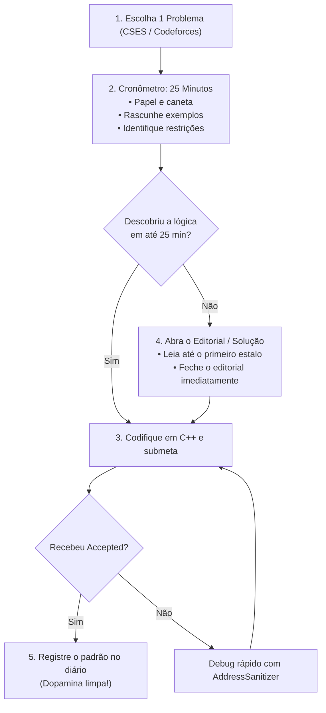

# 🥋 Protocolo de Prática Deliberada: Rumo à Elite

> **Propósito:** Guia mestre e registro contínuo de treino para elevar o nível de programação do zero até o padrão de excelência de empresas como **Google**, **Jane Street** e maratonas internacionais (**Codeforces / ICPC**).
>
> Baseado nos princípios de **Prática Deliberada** de K. Anders Ericsson: foco no limite do desconforto, eliminação de atrito cognitivo e feedback imediato.

---

## 🧭 1. Princípios Inegociáveis de Treino

1. **A Regra de Ouro da Distribuição Diária:**
   - **50% — Resolução Ativa de Problemas em C++** ([CSES](https://cses.fi/problemset/) / Codeforces / Beecrowd).
   - **30% — Engenharia de Software, C++ Moderno e Fundamentos** (Projetos, Univesp, arquitetura de sistemas).
   - **20% — Inglês Instrumental Embutido** (leitura direta de enunciados, documentação e escuta passiva no deslocamento).
   - **0% — Pré-requisitos artificiais** (proibido gastar blocos nobres com testes de digitação ou estudo de gramática desconectada de código).

2. **O Inglês é Veículo, não Bloqueador:**
   - Mantenha as plataformas técnicas (CSES / Codeforces / LeetCode) sempre em inglês.
   - Use tradução rápida (extensão DeepL / TWP) apenas ao travar em palavras pontuais. O vocabulário de ~250 palavras técnicas será assimilado por repetição direta.

3. **Código de Verdade vs. Ilusão de Competência:**
   - Ler 1.000 páginas sem codificar não ensina programação.
   - O aprendizado real acontece no momento em que seu código falha (Wrong Answer / Time Limit) e você investiga o motivo.

---

## 📚 2. Arsenal Local: Seus Livros & Trilhas

Seu acervo já está disponível localmente na pasta [`Livros`](file:///home/henrique/Livros). Use cada material na fase correta:

### 🟢 Fase 1: Fundação Algorítmica & Raciocínio (Foco Atual)
* [`Competitive Programmers Handbook` (Antti Laaksonen)](file:///home/henrique/Livros/Competitive%20Programmers%20Handbook%20(Antti%20Laaksonen).pdf) — O manual mais direto, enxuto e prático para maratona e entrevistas.
* [`Principles of Algorithmic Problem Solving` (Johan Sannemo)](file:///home/henrique/Livros/Principles%20of%20Algorithmic%20Problem%20Solving%20(Johan%20Sannemo).pdf) — Excelente para desenvolver pensamento invariante e decomposição matemática.
* [USACO Guide (Curadoria de Benjamin Qi / Benq)](https://usaco.guide/) — O melhor currículo estruturado do mundo (Bronze $\rightarrow$ Silver $\rightarrow$ Gold $\rightarrow$ Platinum).
* [Tracker de Playlists da Maratona UFMG](file:///home/henrique/Maratonas/progresso_playlists.md) — Teoria aprofundada em português para conceitos difíceis.

### 🟡 Fase 2: Engenharia de Sistemas & Consulta (Médio Prazo)
* [`C++ Primer (5ª Edição)` (Stanley B. Lippman)](file:///home/henrique/Livros/C++%20Primer%20(5th%20Edition)%20-%20Stanley%20B.%20Lippman.pdf) — Consulte conforme surgirem dúvidas de sintaxe moderna e STL.
* [`TCP/IP Sockets in C: Practical Guide for Programmers`](file:///home/henrique/Livros/TCP_IP%20Sockets%20in%20C%20-%20Practical%20Guide%20for%20Programmers.pdf) — Base para redes de computadores e sistemas de alta performance.
* [`The Algorithm Design Manual` (Steven S. Skiena)](file:///home/henrique/Livros/The%20Algorithm%20Design%20Manual%20-%20Steven%20S.%20Skiena.pdf) — Catálogo de soluções práticas e heurísticas para entrevistas.

### 🔴 Fase 3: Raciocínio Quantitativo Avançado (Jane Street Bar)
* [`A Practical Guide to Quantitative Finance Interviews (Green Book)` (Xinfeng Zhou)](file:///home/henrique/Livros/A%20Practical%20Guide%20to%20Quantitative%20Finance%20Interviews%20(Green%20Book)%20-%20Xinfeng%20Zhou.pdf) — Probabilidade, valor esperado, martingales e cálculo mental.

---

## ⚡ 3. O Algoritmo dos 25 Minutos (Anti-Paralisia TDAH)

Para vencer a inércia e o perfeccionismo paralisante:



> [!IMPORTANT]
> **Regra do Editorial:** Se precisou ler a solução ou o editorial, **nunca copie e cole**. Apague o que viu, digite o código do zero na sua máquina, entenda cada linha e garanta o seu *Accepted*.

---

## 🎯 4. Escada de Marcos e Níveis

```
[Nível 4] 🟠 Rating 1900+ (Candidate Master / Master) ── Jane Street SWE / Citadel
          • Grafos avançados, DP em árvores/máscaras, projeto de Order Book de baixa latência em C++20.

[Nível 3] 🔵 Rating 1600–1800 (Expert) ─────────────── Google SWE Bar Atingido
          • CSES Graph Algorithms e Dynamic Programming dominados. LeetCode Hard vira rotina.

[Nível 2] 🟢 Rating 1400 (Specialist) ──────────────── Fim definitivo do "Dev Fraco"
          • CSES Sorting & Searching zerado. Busca binária na resposta, two pointers, prefix sums rápidos.

[Nível 1] 🟢 Rating 1200 (Pupil) ───────────────────── Meta Imediata
          • CSES Introductory zerado. STL do C++ no sangue (vector, pair, map, set, sort).
```

---

## 🛠️ 5. Ambiente de Guerra no NixOS

Para compilar rapidamente com detecção de falhas de memória e comportamentos indefinidos:

### Entrar no ambiente com GCC e depuradores:
```bash
nix-shell -p gcc gdb clang-tools
```

### Script de compilação estrita (para pegar bugs na hora):
```bash
g++ -std=c++20 -O2 -Wall -Wextra -fsanitize=address,undefined sol.cpp -o sol
./sol
```

---

## 📝 6. Diário de Bordo da Prática Deliberada

Preencha a cada problema resolvido para medir a evolução real:

| Data | Plataforma / Problema | Tópico Principal | Tempo | Usou Editorial? | Insight / Padrão Aprendido |
| :---: | :--- | :--- | :---: | :---: | :--- |
| `2026-10-20` | CSES - Weird Algorithm (1068) | Simulação / Collatz | — min | [ ] Sim [ ] Não | Uso de `long long` para evitar estouro de 32-bits no $3n+1$. |
| | | | | [ ] Sim [ ] Não | |
| | | | | [ ] Sim [ ] Não | |
| | | | | [ ] Sim [ ] Não | |
| | | | | [ ] Sim [ ] Não | |

---

*Arquivo criado para servir de bússola pessoal. Mantenha este documento aberto durante suas sessões de treino.*
